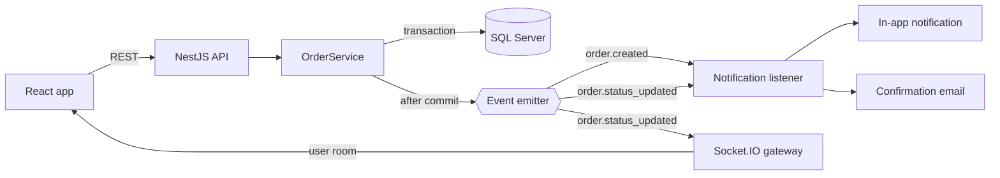

# Event-Driven Ecommerce

A food ordering website where customers browse the menu, add dishes to their cart, place orders, pay with VNPay (sandbox) and follow their order status in real time. Admins manage dishes, categories and orders from a dashboard.

**Stack:** NestJS 11 · Prisma 7 · SQL Server 2022 · React 19 · Vite · Tailwind CSS · Zustand · Socket.IO · Docker + nginx

<!-- Screenshots: put images in docs/screenshots/ and uncomment


-->

## Features

- **Customers:** register and log in (JWT with refresh tokens), browse and search dishes, cart, checkout, order history, real-time order status and in-app notifications.
- **Admins:** manage dishes, categories and orders, and view sales on a dashboard.
- **Payments:** VNPay sandbox with HMAC-SHA512 signature checks, amount validation and idempotent callbacks, so a repeated callback never updates a payment twice.

## Architecture

Order side effects are event-driven. The order service saves the order, commits the transaction and only then publishes an event. Listeners handle notifications, emails and real-time updates on their own, so a slow email server never slows down checkout.



Events are handled in-process with `@nestjs/event-emitter`. A crash can lose an event that has not been handled yet. An outbox table or a queue such as BullMQ would close that gap.

## Performance and reliability

- **No duplicate orders:** checkout runs in one transaction and locks the cart row. `READ_COMMITTED_SNAPSHOT` removed the deadlocks that k6 found under concurrent checkout (errors went from 14.5% to 0% at 20 virtual users).
- **Catalog cache:** product and category reads are cached for 30 seconds. Concurrent cache misses share one query, and every write clears the cache.
- **Indexes** on the main read paths (products by category, orders and notifications by user).
- **Tuning:** a database pool of 30 connections, and 16 libuv threads so bcrypt logins don't block other requests.
- **Rate limiting:** 600 requests per minute per IP, 10 login attempts and 5 registrations per minute per IP.
- **Resilience:** graceful shutdown lets in-flight requests finish, client requests time out after 15 seconds, and checkout checks whether an order was saved when the reply was lost.

### Load test results

Measured on one local machine (API, database and test client together), 50 concurrent connections, 15 seconds per endpoint:

| Endpoint | Before | After |
|---|---|---|
| Product list | 247 req/s | ~1,719 req/s |
| Category list | 586 req/s | ~2,458 req/s |
| Search (not cached) | 213 req/s, p95 296 ms | 257 req/s, p95 264 ms |

The full shopping flow (log in, browse, add to cart, check out) ran with **300 concurrent users at ~119 req/s with 0 errors**.

Run them yourself against a running API started with `THROTTLE_DISABLED=true` (the scripts send everything from one IP):

```bash
cd backend
npm run load-test -- http://localhost:3000 50 15               # read-only
npm run journey-test -- http://localhost:3000 100 30 --write   # creates users and orders: use a test database
```

## Getting started

### With Docker

Copy `.env.example` to both `.env` and `backend/.env`, fill in the values, then run:

```bash
docker compose up --build
```

The frontend is served at http://localhost and the API at http://localhost:3000. The backend runs migrations and the seed on start. The `admin` account is created only when `ADMIN_PASSWORD` is set.

### Local development

Requires Node.js and a SQL Server instance.

```bash
npm install                      # installs both workspaces
cd backend && npx prisma migrate deploy && cd ..
npm run dev:backend
npm run dev:frontend
```

Run the backend tests with `npm test --workspace=backend`.

## Project structure

```
backend/    NestJS API: auth, product, category, cart, order, payment, notification, dashboard
frontend/   React app for customers and admins
```

> This is a portfolio project. VNPay runs in **sandbox** mode and takes no real money.
